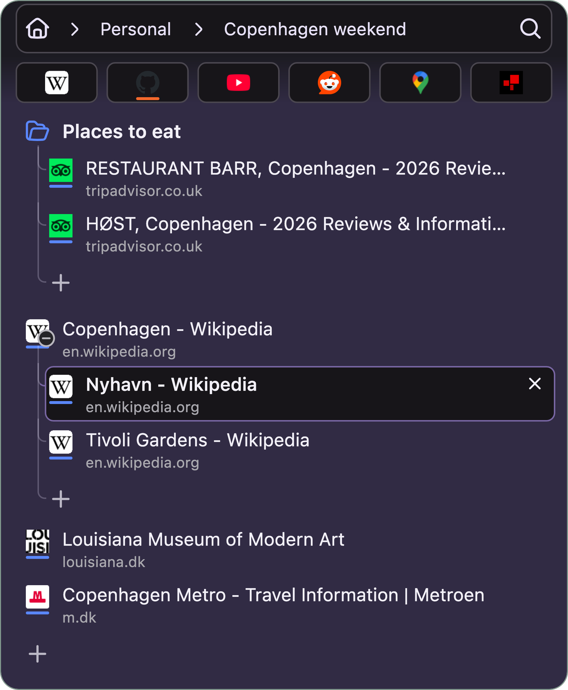

# Tabernacle

Tabernacle is a Firefox extension I made to help me navigate and organise my tabs. It adds a sidebar with folders, nested tab trees and search.

- Organise tabs into folders and subfolders, and focus on one folder at a time.
- Keep related tabs in collapsible trees, with drag and drop to move or nest them.
- Search folders, tab titles and URLs.
- Use Firefox containers and set default containers for folders.
- Access pinned tabs and folders, mute audio and reopen recently closed tabs.
- Revisit viewed tabs, recently opened folders and closed tabs in one searchable timeline.

Requires Firefox 142 or newer.

## Keep related tabs together

Organise tabs into folders, subfolders and nested trees in your Firefox sidebar.

## Focus on one folder

Open a folder to see just its tabs. Use the folder path to move back up.

## Find tabs in any folder

Search tab titles, URLs and folder names, including in collapsed folders.

## Keep sign-ins separate

Choose a Firefox container for new tabs, or set a default container for each folder.

## Choose how the sidebar looks

Tabernacle follows your Firefox theme automatically. It recognises Firefox Default and Mozilla’s Sun, Spark, Flame, Flare, Lavender, Dusk, Lagoon, Pine, Tide, Ash and Smoke themes, using bundled light/dark palettes and gradients. Other themes use the colours Firefox exposes; Firefox may return their base palette even when a separate dark variant is displayed. Third-party background images are not loaded.

Click the **Settings** cog at the bottom of the sidebar, or use **Preferences** for Tabernacle in Firefox’s Add-ons Manager. Settings open in a full browser tab, with sections for Appearance, Containers, Backup and restore, Shortcuts and About.

In **Settings → Appearance**, choose **Follow Firefox** or **Monochrome**. **Monochrome colour mode** controls the neutral palette when selected manually or used as a fallback: **Follow Firefox**, **Light** or **Dark**. Save applies your preferences to every window. You can also show website domains and lines connecting nested tabs.

Theme identification requires Firefox’s **management** permission, which provides installed add-on information. Tabernacle uses it to identify the enabled theme; it does not store or transmit the installed add-on list or change Firefox’s theme. Mozilla palettes are bundled locally, with sources and licences in `extension/themes/NOTICE.txt`. No theme downloads happen at runtime.

## Back up your folders

In **Settings → Backup and restore**, export your folder tree to a JSON file. It includes folder order, icons, colours and default containers. Pin preferences, pinned strip layouts, tabs, browsing activity, cookies and sign-ins aren’t included.

Import a backup into **Home**, an existing folder or a new folder. Preview shows which folders will be created or reused. Matching uses exact folder names within each parent; duplicate names are paired in sibling order. Existing folders keep their settings and order. New folders are added after existing siblings.

For default containers, choose an existing container, create one from the saved name, colour and icon, or select **No container**. Inherited defaults follow the destination folder’s ancestry. Importing the same file into the same destination again adds only folders that are still missing.

## Keep pinned tabs and folders visible

Pin the sites and folders you use most. Their icons stay visible in every folder. Right-click a folder and choose **Pin folder…**, then choose whether clicking its pin should **Open folder** or **Show in tree**. Both actions remain available on right-click, along with **Change default action…** and **Unpin folder**.

**Open folder** focuses the sidebar on its contents. **Show in tree** expands and reveals the folder without switching your active tab. Pins use the folder’s existing icon and colour; hover to see its path and click action.

Drag folder and tab pins into any order. Folder pins, their default actions and their relative order are shared across windows. Each window keeps its own arrangement of folder and tab positions, with tabs following Firefox’s pinned-tab order.

