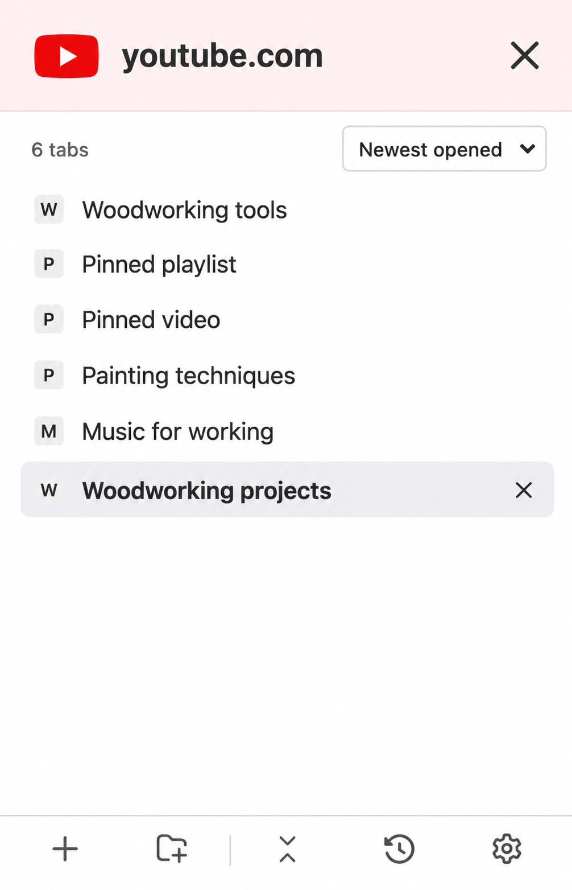

# Domain header mockup

Generated with the built-in image generation tool on 16 October 2026, using `test-results/domain-filter-320.png` as the style and layout reference.



A dedicated domain header replaces the search interface: large favicon and domain, a pale background based on the favicon colour, and an exit button returning to the normal tree. The result count and sort selector remain underneath.

## Generation prompt

```text
Use case: ui-mockup.
Create ONE crisp, high-fidelity mockup image of the Tabernacle browser sidebar with a redesigned domain focus header. The attached screenshot is a reference for the actual app's layout, density, typography and neutral styling. Produce a flat, straight-on screenshot-style portrait image of a single sidebar, roughly 360 CSS pixels wide and 560 CSS pixels tall, rendered at high resolution. Fill the image with the app interface; no device frame, perspective, captions outside the app or presentation title.

Primary change: completely REPLACE the top search capsule with a full-width domain header. This is a dedicated domain view, not search. No magnifying glass, no search input, no placeholder, no "domain:" prefix, no badge/pill/block around the domain name, and no breadcrumb.
Header: approximately 76 CSS pixels high, with a very pale washed-out YouTube-red background, near #fff0f0. Flat solid fill, subtle lower divider, no heavy border, no enclosing rounded search box. In one vertically centred horizontal row: a large recognisable red YouTube play favicon on the left, approximately 36 CSS pixels wide; the exact text "youtube.com" immediately beside it in large dark charcoal semibold system type, approximately 22 CSS pixels; a large clearly drawn charcoal X close button on the far right, approximately 26 CSS pixels, with a generous click target. Comfortable but compact spacing, domain fully visible. The X is the action to leave this domain view and return to the normal tabs-and-folders interface. Do not label it "Close tab", do not add a back arrow.

Below the pale-red header preserve a WHITE compact results toolbar: "6 tabs" left and the current "Newest opened" dropdown right. Keep the toolbar separate from the domain heading. Then the familiar flat, compact tab list, dark text, simple small favicons, no cards or large thumbnails:
"Woodworking tools"
"Pinned playlist"
"Pinned video"
"Painting techniques"
"Music for working"
"Woodworking projects"
Preserve the reference screenshot's small neutral square monogram favicons in rows. The last row is active with a subtle light grey-lavender selection fill and semibold title, and a small close X on its right. Other rows have no persistent close X. Keep the active-row X much smaller than the header's exit X to distinguish their roles. Rows approximately 30 CSS pixels high.

Preserve the white list background and bottom footer with its thin divider and five familiar grey icons: plus, folder-plus, fold, recent history, settings. Leave modest white breathing room between list and footer. The tinted colour belongs ONLY to the domain header; the list and toolbar stay white. Faithful to the existing small practical desktop utility: clean lines, restrained corner radii, precise alignment, legible native-system typography. Do not introduce extra controls, slogans, settings panels, mockup annotations or decorative shadows.
```
