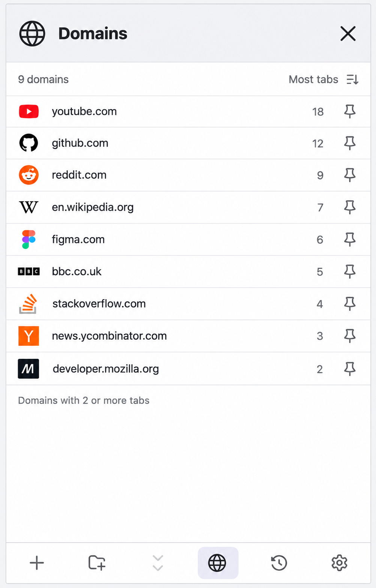
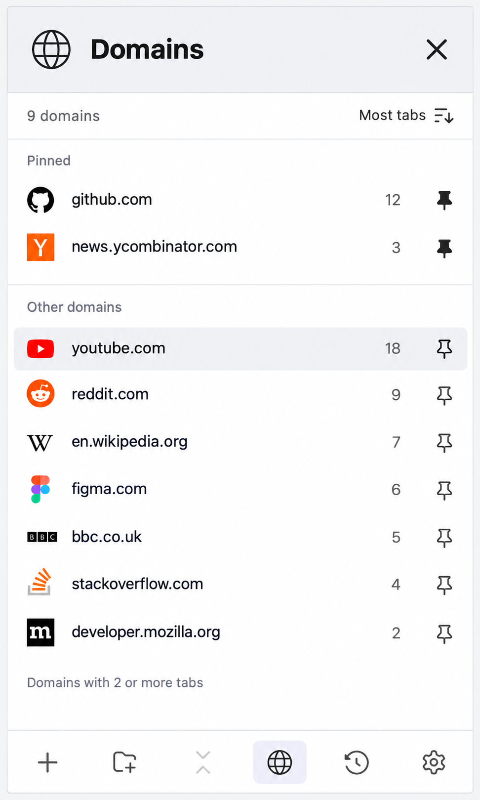
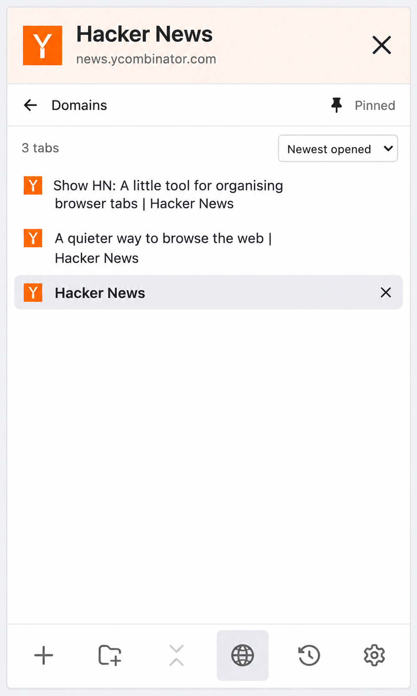

# Domains browser mockups

Generated on 17 October 2026 with the built-in image generation tool, using the existing `test-results/domain-site-name-480.png` interface as the visual reference and the MP-DEV style guide. These are illustrative UI concepts. No extension code was changed for these mockups.

## 1. Domains list

A globe button in the bottom toolbar opens a dedicated Domains view, replacing the tree, search and pinned-tabs strip. Domains with two or more open tabs appear in descending tab-count order. Each row has a favicon, domain, count and pin control.

## 2. Pinned domains

GitHub and Hacker News are pinned above the remaining domains. The remaining list retains descending tab-count order and omits the pinned entries. Filled pins distinguish pinned domains from available pin actions.

## 3. Selected domain

Selecting Hacker News opens the existing domain-filter presentation. A compact Domains back action returns to the directory; the large X returns to the normal tree. The globe stays selected in the footer. The illustrated three-tab count matches the directory.

## Prompts

The exact prompt set is in [prompts.json](prompts.json). All example tab counts and page titles are illustrative. The images are design proposals rather than functional screenshots.
