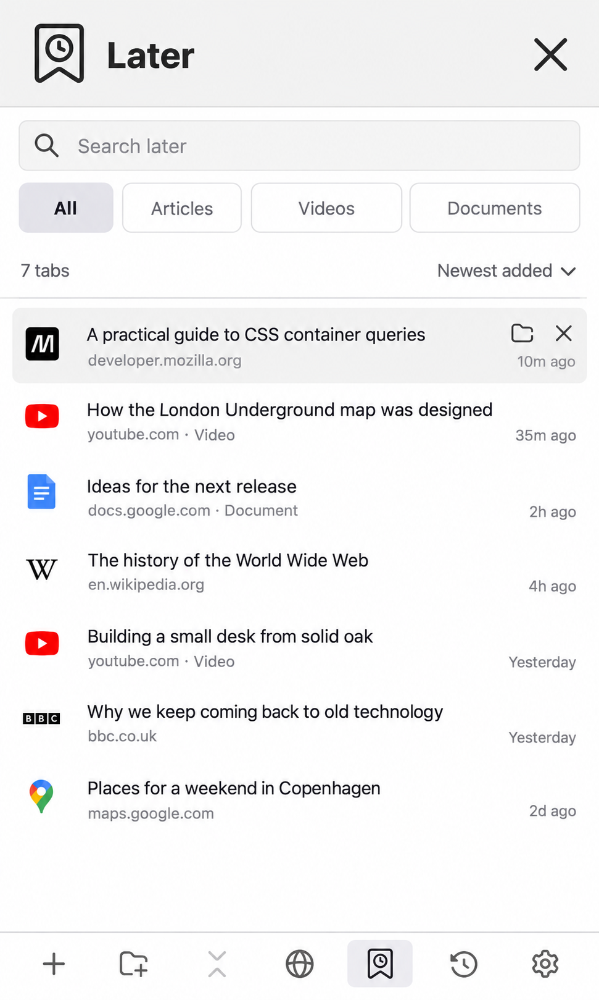

# Later mockup

Generated on 17 October 2026 with the built-in image generation tool, using `test-results/domains-pinned-320.png` as the interface reference and the MP-DEV style guide. This is an illustrative design proposal; example titles and timestamps are fictional.

The Later button sits between Domains and recent activity in the bottom toolbar. It opens a dedicated view with search and All, Articles, Videos and Documents filters. All is selected here, showing seven tabs in newest-added order. The Maps entry illustrates that All can also contain tabs outside the three quick filters.

Rows show the favicon, title, domain and time added. The hovered first row exposes return-to-folder and close controls. The header close button returns to the tree. No extension code was changed for this mockup.

The exact generation prompt is saved in [prompts.json](prompts.json).
