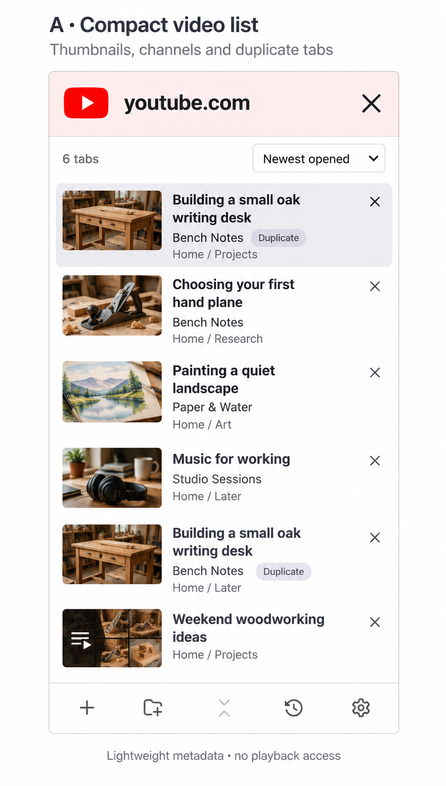
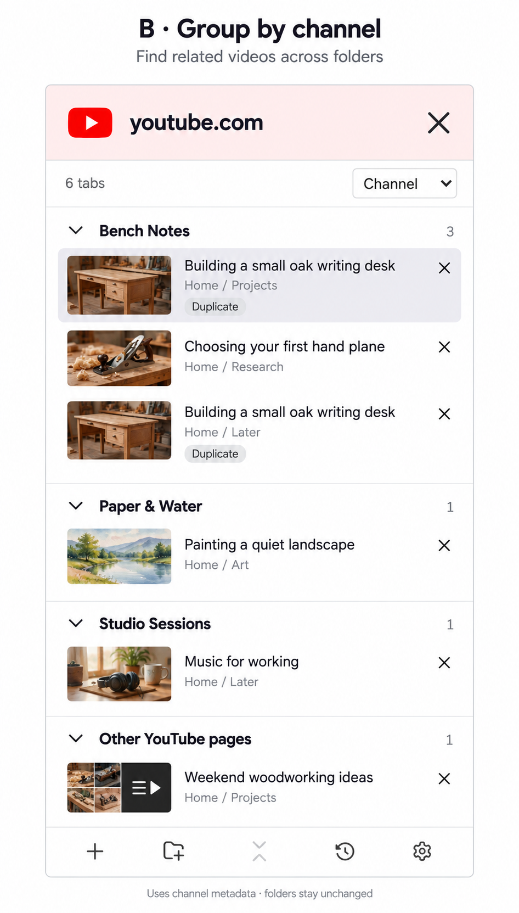
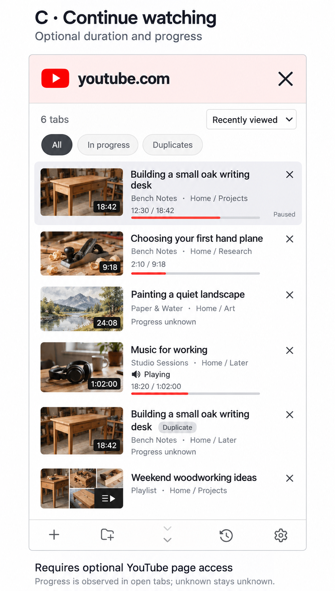

# YouTube results concepts

Generated on 16 October 2026 with the built-in image generation tool. These are visual concepts, using illustrative video titles, channel names, thumbnails and playback positions. No extension code was changed.

Reference: `test-results/domain-wrapped-results-320.png`, the existing domain-results interface.

## A — Compact video list



Thumbnails, channel names, original folders and duplicate-video indicators. Recommended starting point. Basic metadata lookups and cached images; no playback access. The illustrated playlist artwork is a design placeholder and would need an available image source or a playlist-icon fallback.

## B — Group by channel



The same tabs grouped by channel, with separate rows for duplicate tabs and a section for other YouTube pages. These groups do not change the underlying folders.

## C — Continue watching



Duration, observed playback position, playback state and filters. Requires an additional integration with optional YouTube page access for player data. Unknown progress remains unknown; this is not account-wide watch history. Sleeping tabs need cached information or a fallback and should not be awakened to fill these fields.

## Generation prompts

### a-compact-list

```text
Use case: ui-mockup.
Create one crisp, high-fidelity product design mockup for the Tabernacle Firefox sidebar. Image 1 is a STYLE AND LAYOUT REFERENCE showing the actual app, not content to reproduce exactly. The concept is a YouTube-specific presentation of existing open tabs. This is a design exploration, not a released feature.
Composition: a straight-on flat portrait design board, roughly 1000 by 1800 pixels, with a small concept title and subtitle above ONE generously sized sidebar mockup. The sidebar represents about 360 CSS pixels wide by 700 CSS pixels tall. White or very pale grey board backdrop, thin outline around the sidebar, no perspective, no device frame, no browser chrome. Make all interface text crisp and readable.
Keep the app's visual identity: white surface, dark charcoal system sans-serif type, quiet grey metadata, restrained 6px corner radii, fine divider lines. Preserve the pale washed-out red 76px-tall full-width header with large red YouTube play favicon, bold "youtube.com", and a large X at the far right. No search field, domain badge, breadcrumbs or back arrow. Keep a separate compact white count/sort toolbar below it. Preserve the bottom toolbar with plus, folder-plus, fold chevrons, recent history and settings icons. Preserve ordinary small row-close X buttons, distinct from the large header X. Selecting a row activates an already-open browser tab. There is no embedded video player.
Use small realistic photographic video thumbnails, not monogram favicons, for videos: oak desk in a workshop, hand plane on a workbench, a painted watercolour landscape, a quiet desk with headphones. Thumbnails are about 80x45 CSS pixels. Titles wrap naturally to at most 3 lines. Avoid decorative giant cards, shadows, marketing text, invented metrics and oversized typography.
Use this six-tab example dataset consistently: (1) "Building a small oak writing desk" by "Bench Notes", folder "Home / Projects"; (2) "Choosing your first hand plane" by "Bench Notes", folder "Home / Research"; (3) "Painting a quiet landscape" by "Paper & Water", folder "Home / Art"; (4) "Music for working" by "Studio Sessions", folder "Home / Later"; (5) another separate tab of "Building a small oak writing desk" by "Bench Notes", folder "Home / Later"; (6) a playlist page "Weekend woodworking ideas", in folder "Home / Projects". Use an ordinary small playlist icon for the playlist page. Show all six as separate rows. The two oak-desk rows have matching thumbnails and may have a small "Duplicate" badge. Never pretend the playlist is an individual video.

Concept title outside the sidebar: "A · Compact video list". Subtitle: "Thumbnails, channels and duplicate tabs".
Toolbar inside app: "6 tabs" left; "Newest opened" dropdown right.
Layout: six compact, flat horizontal rows; thumbnail on left, title and channel name to its right, small close X aligned to first title line at right. Show muted folder paths as a final small line for each row. Discreet "Duplicate" badge next to the channel on both oak-desk rows. The first row is selected with the reference app's pale grey-lavender fill, semibold title and visible X. Other rows may show small X only subtly, do not look like large buttons.
No durations, playback progress, views, dates, watched labels or playback controls in this concept. Make it immediately useful for visually recognising open tabs and finding duplicates without losing the existing compact sidebar character.
A small caption outside the app at bottom: "Lightweight metadata · no playback access".
```

### b-by-channel

```text
Use case: ui-mockup.
Create one crisp, high-fidelity product design mockup for the Tabernacle Firefox sidebar. Image 1 is a STYLE AND LAYOUT REFERENCE showing the actual app, not content to reproduce exactly. The concept is a YouTube-specific presentation of existing open tabs. This is a design exploration, not a released feature.
Composition: a straight-on flat portrait design board, roughly 1000 by 1800 pixels, with a small concept title and subtitle above ONE generously sized sidebar mockup. The sidebar represents about 360 CSS pixels wide by 700 CSS pixels tall. White or very pale grey board backdrop, thin outline around the sidebar, no perspective, no device frame, no browser chrome. Make all interface text crisp and readable.
Keep the app's visual identity: white surface, dark charcoal system sans-serif type, quiet grey metadata, restrained 6px corner radii, fine divider lines. Preserve the pale washed-out red 76px-tall full-width header with large red YouTube play favicon, bold "youtube.com", and a large X at the far right. No search field, domain badge, breadcrumbs or back arrow. Keep a separate compact white count/sort toolbar below it. Preserve the bottom toolbar with plus, folder-plus, fold chevrons, recent history and settings icons. Preserve ordinary small row-close X buttons, distinct from the large header X. Selecting a row activates an already-open browser tab. There is no embedded video player.
Use small realistic photographic video thumbnails, not monogram favicons, for videos: oak desk in a workshop, hand plane on a workbench, a painted watercolour landscape, a quiet desk with headphones. Thumbnails are about 80x45 CSS pixels. Titles wrap naturally to at most 3 lines. Avoid decorative giant cards, shadows, marketing text, invented metrics and oversized typography.
Use this six-tab example dataset consistently: (1) "Building a small oak writing desk" by "Bench Notes", folder "Home / Projects"; (2) "Choosing your first hand plane" by "Bench Notes", folder "Home / Research"; (3) "Painting a quiet landscape" by "Paper & Water", folder "Home / Art"; (4) "Music for working" by "Studio Sessions", folder "Home / Later"; (5) another separate tab of "Building a small oak writing desk" by "Bench Notes", folder "Home / Later"; (6) a playlist page "Weekend woodworking ideas", in folder "Home / Projects". Use an ordinary small playlist icon for the playlist page. Show all six as separate rows. The two oak-desk rows have matching thumbnails and may have a small "Duplicate" badge. Never pretend the playlist is an individual video.

Concept title outside the sidebar: "B · Group by channel". Subtitle: "Find related videos across folders".
Toolbar inside app: "6 tabs" left; "Channel" dropdown right.
Layout: muted collapsible group headings followed by compact flat rows with 72x41 thumbnails, titles at most three lines, original folder path beneath and small close X. Group headings: "Bench Notes" with count "3"; "Paper & Water" with count "1"; "Studio Sessions" with count "1"; "Other YouTube pages" with count "1". Bench Notes contains the two separate oak-desk tabs and the hand-plane tab. Paper & Water contains landscape video, Studio Sessions contains music video, Other YouTube pages contains the playlist. Channel names belong to group headers and need not be repeated on every row. Duplicate oak-desk rows carry a small quiet "Duplicate" label. Keep all 6 rows visible, with modest vertical spacing between groups. The first oak-desk row has the pale grey-lavender active fill. Group headings are temporary visual organisation, not new folders; don't draw folder icons for channel headings.
No duration, watched indicators, playback controls, progress, API labels or video counts beyond the actual tab group counts.
A small caption outside the app at bottom: "Uses channel metadata · folders stay unchanged".
```

### c-progress

```text
Use case: ui-mockup.
Create one crisp, high-fidelity product design mockup for the Tabernacle Firefox sidebar. Image 1 is a STYLE AND LAYOUT REFERENCE showing the actual app, not content to reproduce exactly. The concept is a YouTube-specific presentation of existing open tabs. This is a design exploration, not a released feature.
Composition: a straight-on flat portrait design board, roughly 1000 by 1800 pixels, with a small concept title and subtitle above ONE generously sized sidebar mockup. The sidebar represents about 360 CSS pixels wide by 700 CSS pixels tall. White or very pale grey board backdrop, thin outline around the sidebar, no perspective, no device frame, no browser chrome. Make all interface text crisp and readable.
Keep the app's visual identity: white surface, dark charcoal system sans-serif type, quiet grey metadata, restrained 6px corner radii, fine divider lines. Preserve the pale washed-out red 76px-tall full-width header with large red YouTube play favicon, bold "youtube.com", and a large X at the far right. No search field, domain badge, breadcrumbs or back arrow. Keep a separate compact white count/sort toolbar below it. Preserve the bottom toolbar with plus, folder-plus, fold chevrons, recent history and settings icons. Preserve ordinary small row-close X buttons, distinct from the large header X. Selecting a row activates an already-open browser tab. There is no embedded video player.
Use small realistic photographic video thumbnails, not monogram favicons, for videos: oak desk in a workshop, hand plane on a workbench, a painted watercolour landscape, a quiet desk with headphones. Thumbnails are about 80x45 CSS pixels. Titles wrap naturally to at most 3 lines. Avoid decorative giant cards, shadows, marketing text, invented metrics and oversized typography.
Use this six-tab example dataset consistently: (1) "Building a small oak writing desk" by "Bench Notes", folder "Home / Projects"; (2) "Choosing your first hand plane" by "Bench Notes", folder "Home / Research"; (3) "Painting a quiet landscape" by "Paper & Water", folder "Home / Art"; (4) "Music for working" by "Studio Sessions", folder "Home / Later"; (5) another separate tab of "Building a small oak writing desk" by "Bench Notes", folder "Home / Later"; (6) a playlist page "Weekend woodworking ideas", in folder "Home / Projects". Use an ordinary small playlist icon for the playlist page. Show all six as separate rows. The two oak-desk rows have matching thumbnails and may have a small "Duplicate" badge. Never pretend the playlist is an individual video.

Concept title outside the sidebar: "C · Continue watching". Subtitle: "Optional duration and progress".
Toolbar inside app: "6 tabs" left; "Recently viewed" dropdown right. Add one restrained filter-chip row beneath: "All" selected, "In progress", "Duplicates".
Layout: compact thumbnail rows with title and channel, close X, plus an understated progress line only where progress was observed. Thumbnail for first oak-desk row has small dark corner duration badge "18:42"; text below row "12:30 / 18:42" and a thin muted red progress bar about two-thirds across. The row is selected with a pale grey-lavender fill; a subtle "Paused" state, no play button. The hand-plane thumbnail duration "9:18", progress label "2:10 / 9:18", thin progress bar about one quarter across. Landscape duration "24:08", quiet status "Progress unknown" and no progress bar. Music thumbnail duration "1:02:00", a little speaker glyph with "Playing", progress "18:20 / 1:02:00" and thin progress bar about 30 percent across. Second oak-desk tab shows matching thumbnail and "Duplicate" marker with quiet "Progress unknown" and no progress bar; it is a separate tab. The playlist page remains an ordinary playlist row, no duration or progress. All six rows fit visibly inside the sidebar.
Keep this practical and restrained: no view counts, likes, subscriber counts, full watched history, autoplay, live moving preview, or giant watch buttons.
Caption outside the app at bottom, very legible: "Requires optional YouTube page access". A smaller second line: "Progress is observed in open tabs; unknown stays unknown."
```
